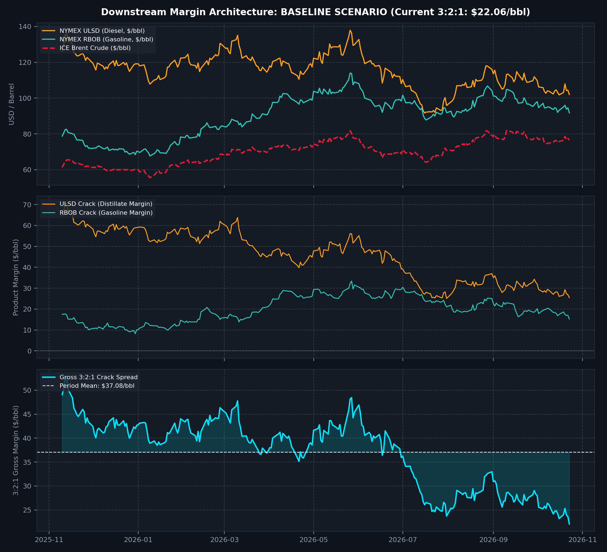
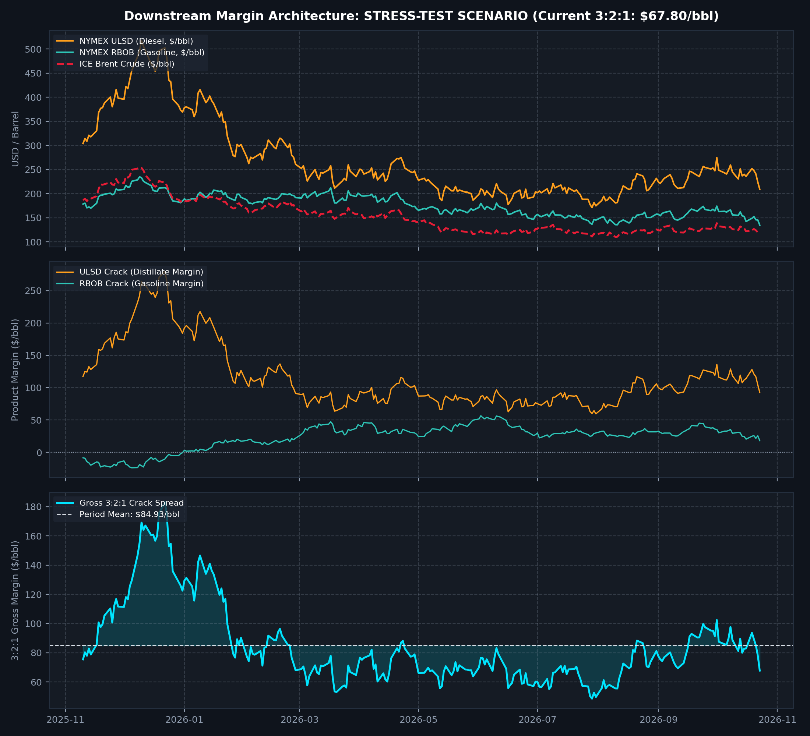

# Dual-Mode 3:2:1 Refinery Crack Margin Engine

[](https://www.python.org/downloads/)
[](https://opensource.org/licenses/MIT)

An institutional-grade refinery margin analytics engine designed for energy trading desks and downstream analysts. It models the standardized **3:2:1 crack spread** across light sweet crude and secondary refined products under both **normalized market equilibrium** and **geopolitical supply-shock regimes**, calibrated against official Bloomberg Terminal settlement metadata (`PX_LAST` / `PX_SETTLE_LAST_DT`).

---

## 1. Executive Summary & Conversion Economics

The **3:2:1 crack spread** models the standard conversion margin of a complex distillation and catalytic cracking refinery:

$$\text{Gross Crack Margin}_{3:2:1} = \frac{2 \times P_{\text{ULSD}} + 1 \times P_{\text{RBOB}} - 3 \times P_{\text{Brent}}}{3}$$

* **Feedstock (3 Barrels)**: ICE Brent prompt futures benchmark (`CO1 Comdty`).
* **Middle Distillates (2 Barrels)**: NYMEX Ultra-Low Sulfur Diesel (`HO1 Comdty`).
* **Light Distillates (1 Barrel)**: NYMEX Reformulated Blendstock for Oxygenate Blending (`XB1 Comdty`).

```
+-----------------------------------------------------------------------------------------+
|                                3:2:1 CRACK SPREAD ARCHITECTURE                          |
|                                                                                         |
|  [ 3 bbls ICE Brent Crude ]  ---> [ Refinery Conversion ] ---> [ 2 bbls NYMEX ULSD ]    |
|       ($/barrel)                                           ---> [ 1 bbl NYMEX RBOB ]    |
+-----------------------------------------------------------------------------------------+
```
  ---

## 2. Market Ingestion & Settlement Metadata

All terminal inputs are anchored directly to official **Bloomberg Terminal** futures settlement feeds (`PX_LAST` / `PX_SETTLE_LAST_DT`):

| Commodity Benchmark | Bloomberg Ticker | Exchange | PX_LAST | Contract Quoting Unit | Normalized Price ($/bbl) | PX_SETTLE_LAST_DT |
| :--- | :--- | :--- | :--- | :--- | :--- | :--- |
| **ICE Brent Crude** | `CO1 Comdty` | ICE | 116.72 | USD / bbl | \$116.72 | 2026-10-26 |
| **NYMEX ULSD (Diesel)** | `HO1 Comdty` | NYMEX | 498.42 | USd / gal | \$209.34 | 2026-10-27 |
| **NYMEX RBOB (Gasoline)** | `XB1 Comdty` | NYMEX | 321.16 | USd / gal | \$134.89 | 2026-10-27 |

> **Exchange Settlement Note**: Settlement dates follow exchange-mandated contractual expiration and roll calendars (`PX_SETTLE_LAST_DT`), where NYMEX products and ICE crude adhere to respective official expiry conventions[cite: 2, 4].

*Unit Harmonization*: Refined oil products are quoted in U.S. cents per gallon on NYMEX. Prices are converted to USD per barrel using the physical standard (42 US gallons per barrel):
$$P_{\text{bbl}} = \left( \frac{P_{\text{cents/gal}}}{100} \right) \times 42$$

---

## 3. Operational Visualizations & Regimes

### Regime A: Baseline Market Monitor
Calibrated to normalized trading bands with stable throughput and balanced fuel distribution.
- **3:2:1 Gross Margin**: `+$22.06 /bbl`



### Regime B: Geopolitical Supply Shock (Distillate Squeeze)
Evaluates systemic secondary distillate dislocations (e.g., European embargoes, catalytic cracking unit outages) and margin elasticity.
- **Stress-Test 3:2:1 Margin**: `+$67.80 /bbl`



---

## 4. Economic Rationale & Institutional Limitations

### What Does an Expanding Crack Spread Imply?
1. **Middle Distillate Tightness**: A surging diesel crack spread ($P_{\text{ULSD}} - P_{\text{Brent}}$) signals industrial and freight transport demand outpacing secondary conversion capacity or depleted regional inventories.
2. **Refinery Utilization Incentives**: Wider cracks incentivize merchant refiners to maximize atmospheric distillation utilization until marginal feedstock costs and product gluts compress margins.

### Why 3:2:1 Gross Crack $\neq$ Refinery Net Cash PnL
The 3:2:1 spread is an **indicative gross margin benchmark**. A physical trading desk or merchant refiner evaluates net profitability by deducting key operational frictions:
* **Operating Expenditures (OpEx)**: Typically \$4.00 – \$7.50 /bbl, heavily influenced by natural gas pricing for steam generation and catalytic hydrotreating (hydrogen production).
* **Yield Slate Asymmetry**: Modern complex refineries (FCC, Delayed Coking, Hydrocracking) do not yield an exact 66.7% diesel / 33.3% gasoline output. They generate heavy residual fuel oil (VLSFO), petrochemical naphtha, and asphalt.
* **Feedstock Quality Differentials**: Brent is light-sweet (API ~38°, Sulfur ~0.4%). Processing medium-sour barrels (e.g., Arab Light, Upper Zakum) requires applying Official Selling Price (OSP) differentials and sulfur-penalty operating adjustments.

---

## 5. Project Structure & Quickstart
```
.
├── crack.py                     # Dual-mode analytics pipeline
├── crack_spread_baseline.png    # Baseline equilibrium monitor output
├── crack_spread_stress-test.png # Extreme shock stress-test output
└── README.md                    # Methodology and desk documentation
```
### Usage

```bash
# Clone the repository
git clone https://github.com/Austinzhu0913/refinery-crack-spread-analytics.git
cd refinery-crack-spread-analytics

# Run baseline operational monitor
python crack.py --mode baseline

# Run Bloomberg supply-shock stress test
python crack.py --mode stress-test
```
